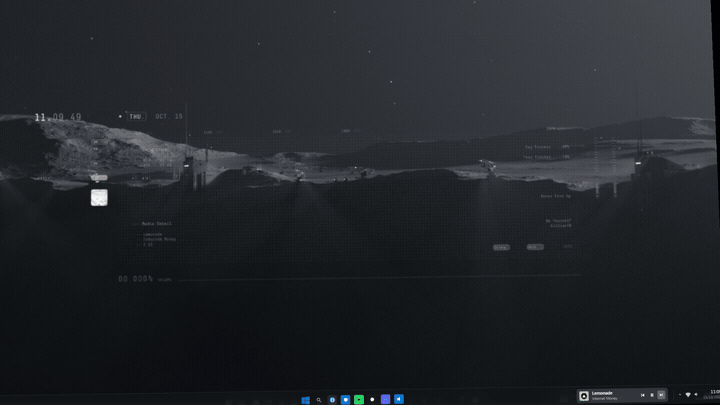

# 🎵 Taskbar Music Widget (Windows 11 / 10)

<p align="center">
  <a href="README.md"><b>English</b></a> | <b>Español</b>
</p>


Un widget nativo, ligero y elegante para la barra de tareas de Windows que proporciona controles multimedia integrados en tiempo real con una interfaz flotante (*Flyout*) inspirada en el diseño Fluent y Spotify.

<p align="center">
  
</p>

<p align="center">
  <a href="assets/TaskbarMusicWidget_Promo_1080p60.mp4">
    
  </a>
</p>

---

## ✨ Características Principales

- **Integración Fluida con la Barra de Tareas:** Se acopla de manera limpia al espacio de la bandeja del sistema sin marcos molestos ni fondos desentonados.
- **Detección Universal de Medios (GSMTC):** Compatible automáticamente con Spotify, YouTube, Twitch, Netflix, Apple TV, DAZN, Soundcloud, VLC, Chrome, Opera, Edge, Brave y cualquier reproductor compatible con Windows Media.
- **Emojis a Todo Color Nativos de Windows 11:** Renderizado vectorial en color real mediante `Segoe UI Emoji` con detección y registro dinámico de símbolos Unicode 16.0 / 17.0 (como `👀`, `🔥`, `🫪`), eliminando por completo cajas vacías (`[]`) y glifos planos en blanco y negro.
- **Tarjeta Flotante Expandible (*Flyout*):** Al pasar el ratón sobre el widget, se despliega una tarjeta flotante interactiva con carátula en alta resolución, título, artista, barra de progreso con desplazamiento manual (*scrubbing*) y controles completos.
- **Barra de Volumen Interactiva con Porcentaje Numérico:** Barra de volumen estilo Spotify situada justo debajo del tiempo de la pista, con botón de silenciar/activar sonido, barra deslizable interactiva con clic y arrastre, porcentaje exacto en tiempo real (ej. `45%`), y ajuste con la rueda del ratón sobre el widget.
- **Centrado y Recorte Inteligente de Miniaturas de YouTube:** Detecta y suprime automáticamente las barras negras de letterboxing 4:3 en miniaturas de YouTube (`hqdefault.jpg`, `sddefault.jpg`), extrayendo un cuadrado 1:1 perfectamente centrado y nítido tanto en el widget de la barra como en la tarjeta flotante.
- **Menú Contextual Fluent Dark y Auto-Cierre Inteligente:** Menú de clic derecho completamente rediseñado al estilo Windows 11 Fluent con iconos vectoriales SVG limpios (recarga, selector de monitor con insignias personalizadas y checkmarks alineados, y botón de cerrar) sin bloques blancos de WPF. Incluye detección de clics en cualquier parte de la pantalla y auto-cierre tras 1.5s de inactividad del cursor.
- **Reubicación Multi-Monitor y Modo Juegos:** Se traslada inteligentemente a la barra de tareas de la pantalla secundaria cuando la principal tiene un juego o vídeo a pantalla completa, filtrando overlays en segundo plano (como el de NVIDIA GeForce Experience) y con soporte completo para fijar manualmente el monitor (*Automático*, *Pantalla 1*, *Pantalla 2*).
- **Animación Cinemática de Texto (*Marquee con KeyFrames*):**
  - Implementado tanto en el widget de la barra como en la tarjeta flotante (*Flyout*).
  - Medición tipográfica exacta subpíxel mediante `FormattedText` y `DesiredSize` para evitar cualquier recorte accidental.
  - Pausas estratégicas de 2 segundos al inicio y al final de cada ciclo, permitiendo leer títulos y nombres de artistas largos con total comodidad y sin prisas.
- **Sustitución de Carátula en YouTube Shorts por el Logo del Canal:** Detecta automáticamente vídeos verticales de YouTube Shorts y sustituye la miniatura cortada por el logo oficial del canal en alta resolución con caché de doble nivel (RAM y disco).
- **Soporte Multilingüe de la Interfaz (Español / English):** Detecta automáticamente el idioma de visualización de Windows (`CultureInfo.CurrentUICulture`), adaptando al instante los textos de la interfaz (como *"Sin música"* / *"No music playing"*), controles del flyout, notificaciones HUD de volumen y menús contextuales, preservando siempre intactos y fidedignos los títulos originales de las canciones y vídeos.
- **Aleatorio Inteligente (*Smart Shuffle*) de Spotify:** Integración bidireccional con Spotify mediante **Windows UI Automation** que detecta y conmuta entre *Desactivado*, *Aleatorio normal* y *Smart Shuffle* con su destello característico (`✦`).
- **Control de Volumen con Rueda del Ratón:** Ajuste directo del volumen maestro del sistema en saltos exactos del **5%** mediante interfaces COM de bajo nivel (**CoreAudio IAudioEndpointVolume**).
- **Enfoque Inteligente y Conmutación de Pestañas:**
  - Al hacer clic en la carátula o título, activa la aplicación correspondiente **sin alterar su tamaño ni desmaximizarla** (incluso en segundas pantallas).
  - En navegadores (Opera, Chrome, Edge), localiza la pestaña exacta que está reproduciendo contenido (por ejemplo, YouTube) y cambia a ella automáticamente mediante UI Automation.
- **Optimización Extrema de Recursos:** Consumo prácticamente nulo de CPU (< 0.1%) y uso reducido de memoria RAM (~30 MB).

---

## 🛠️ Stack Tecnológico y Arquitectura

- **Framework:** .NET 8 (C#) con Windows Presentation Foundation (WPF).
- **Windows Runtime (WinRT):** `Windows.Media.Control.GlobalSystemMediaTransportControlsSessionManager` para escucha de eventos multimedia en tiempo real.
- **Win32 P/Invoke:** Manipulación avanzada de ventanas (`user32.dll`, `dwmapi.dll`), gestión de Z-order (`WS_EX_TOOLWINDOW`, `WS_EX_NOACTIVATE`) y enumeración multi-monitor nativa (`EnumDisplayMonitors`, `GetMonitorInfo`).
- **UI Automation:** `System.Windows.Automation` para inspección de árboles de accesibilidad de Chromium y control de botones nativos entre procesos.
- **COM Interop:** Implementación de `IMMDeviceEnumerator`, `IAudioEndpointVolume` y la interfaz no documentada `IPolicyConfig` para enrutamiento directo de dispositivos de sonido y control de volumen.

---

## 🚀 Instalación y Compilación

### Requisitos
- Windows 10 (versión 19041+) o Windows 11.
- .NET 8 SDK.

### Compilar desde la terminal
```bash
# Clonar el repositorio
git clone https://github.com/KillianTR/TaskbarMusicWidget.git
cd TaskbarMusicWidget

# Compilar proyecto
dotnet build -c Release

# Publicar ejecutable optimizado autoportante
dotnet publish -c Release -r win-x64 --self-contained false -p:PublishSingleFile=true
```

El ejecutable listo para usar se generará en:
`bin/Release/net8.0-windows10.0.19041.0/win-x64/publish/TaskbarMusicWidget.exe`

---

## 📄 Licencia

Este proyecto está bajo la Licencia MIT. Eres libre de usarlo, modificarlo y distribuirlo.
