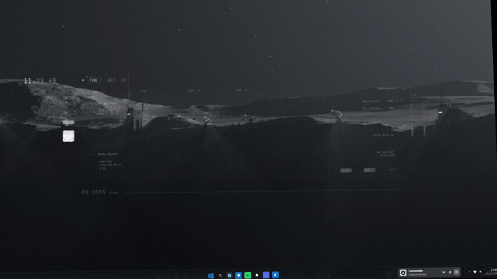

# 🎵 Taskbar Music Widget (Windows 11 / 10)

<p align="center">
  <b>English</b> | <a href="README.es.md"><b>Español</b></a>
</p>


A native, lightweight, and elegant Windows taskbar widget that delivers real-time media controls and an interactive flyout card inspired by Fluent Design and Spotify.

<p align="center">
  
</p>

<p align="center">
  <a href="assets/TaskbarMusicWidget_Promo_1080p60.mp4">
    
  </a>
</p>

---

## ✨ Key Features

- **Seamless Taskbar Integration:** Docks cleanly into the system tray area with zero distracting frames or mismatched backgrounds.
- **Universal Media Detection (GSMTC):** Automatically supports Spotify, YouTube, Twitch, Netflix, Apple TV, DAZN, SoundCloud, VLC, Chrome, Opera, Edge, Brave, and any Windows Media-compatible player.
- **Native Windows 11 Full-Color Emojis:** Native OpenType COLR/CPAL vector emoji rendering using `Segoe UI Emoji` with on-the-fly dynamic registration for modern Unicode 16.0 / 17.0 symbols (such as `👀`, `🔥`, `🫪`), eliminating monochrome glyphs and broken tofu boxes (`[]`).
- **Expandable Interactive Flyout Card:** Hovering over the widget displays an interactive floating card with high-resolution album art, track title, artist name, a full progress bar with manual scrubbing, and playback controls.
- **Interactive Volume Bar & Percentage Display:** Spotify-styled volume slider placed directly below the track timeline, featuring an instant mute/unmute button, click-to-position & drag slider, live volume percentage (e.g., `45%`), plus mouse wheel control over the taskbar widget.
- **Letterbox-Free YouTube Thumbnail Centering:** Automatically detects and strips away letterbox black bars from 4:3 YouTube video thumbnails (`hqdefault.jpg`, `sddefault.jpg`), extracting and centering a pristine 1:1 square video frame in both the taskbar widget and flyout card.
- **Fluent Dark Context Menu & Smart Auto-Dismiss:** Sleek Windows 11 Fluent right-click menu with clean vector SVG icons (reconnect, display monitor with custom badges, and close) without classic WPF white gutter artifacts. Features instant outside-click dismissal and a 1.5-second mouse inactivity timeout.
- **Multi-Monitor Relocation & Gaming Mode:** Intelligently moves to the secondary monitor when the primary screen is occupied by a fullscreen game or video, ignoring background overlays (e.g. NVIDIA GeForce Overlay) with full support for manual display pinning (*Automatic*, *Display 1*, *Display 2*).
- **Cinematic Text Marquee (KeyFrame Animation):**
  - Implemented in both the taskbar widget and the floating card (*Flyout*).
  - Subpixel typographical measurement via `FormattedText` and `DesiredSize` to eliminate premature truncation.
  - Strategic 2-second pauses at the start and end of each cycle, allowing long song titles and artist names to be read comfortably.
- **YouTube Shorts Channel Logo Replacement:** Automatically replaces cropped vertical Shorts thumbnails with the creator's high-resolution official channel logo via two-tier RAM & disk caching.
- **Bilingual Interface Support (English / Spanish):** Automatically detects Windows display language (`CultureInfo.CurrentUICulture`), adapting HUD states (*"No music playing"* / *"Sin música"*), flyout controls, volume toasts, and context menus, while preserving original song and video titles completely untouched.
- **Spotify Smart Shuffle Integration:** Two-way integration with Spotify via **Windows UI Automation** that detects and toggles between *Disabled*, *Normal Shuffle*, and *Smart Shuffle* with its signature sparkle badge (`✦`).
- **Mouse Wheel Volume Control:** Adjust system master volume directly over the widget in precise **5%** steps via low-level COM interfaces (**CoreAudio IAudioEndpointVolume**).
- **Smart Window Focus & Browser Tab Switching:**
  - Clicking the album art or title brings the media application into focus **without unmaximizing or altering its window layout** (even on secondary displays).
  - In Chromium browsers (Opera, Chrome, Edge), intelligently locates the exact background tab playing audio (e.g., YouTube) and switches to it automatically using UI Automation.
- **Ultra-Low Resource Usage:** Virtually 0% CPU (< 0.1%) and minimal RAM footprint (~30 MB).

---

## 🛠️ Tech Stack & Architecture

- **Framework:** .NET 8 (C#) with Windows Presentation Foundation (WPF).
- **Windows Runtime (WinRT):** `Windows.Media.Control.GlobalSystemMediaTransportControlsSessionManager` for real-time media telemetry.
- **Win32 P/Invoke:** Advanced window manipulation (`user32.dll`, `dwmapi.dll`), Z-order layering (`WS_EX_TOOLWINDOW`, `WS_EX_NOACTIVATE`), and multi-monitor enumeration (`EnumDisplayMonitors`, `GetMonitorInfo`).
- **UI Automation:** `System.Windows.Automation` for Chromium accessibility tree inspection and cross-process button automation.
- **COM Interop:** Implementation of `IMMDeviceEnumerator`, `IAudioEndpointVolume`, and undocumented `IPolicyConfig` for hardware audio endpoint routing and volume management.

---

## 🚀 Installation & Build

### Requirements
- Windows 10 (version 19041+) or Windows 11.
- .NET 8 SDK.

### Build from Terminal
```bash
# Clone repository
git clone https://github.com/KillianTR/TaskbarMusicWidget.git
cd TaskbarMusicWidget

# Build project
dotnet build -c Release

# Publish self-contained optimized single-file executable
dotnet publish -c Release -r win-x64 --self-contained false -p:PublishSingleFile=true
```

The ready-to-use executable will be generated at:
`bin/Release/net8.0-windows10.0.19041.0/win-x64/publish/TaskbarMusicWidget.exe`

---

## 📄 License

This project is licensed under the MIT License. Feel free to use, modify, and distribute it.
